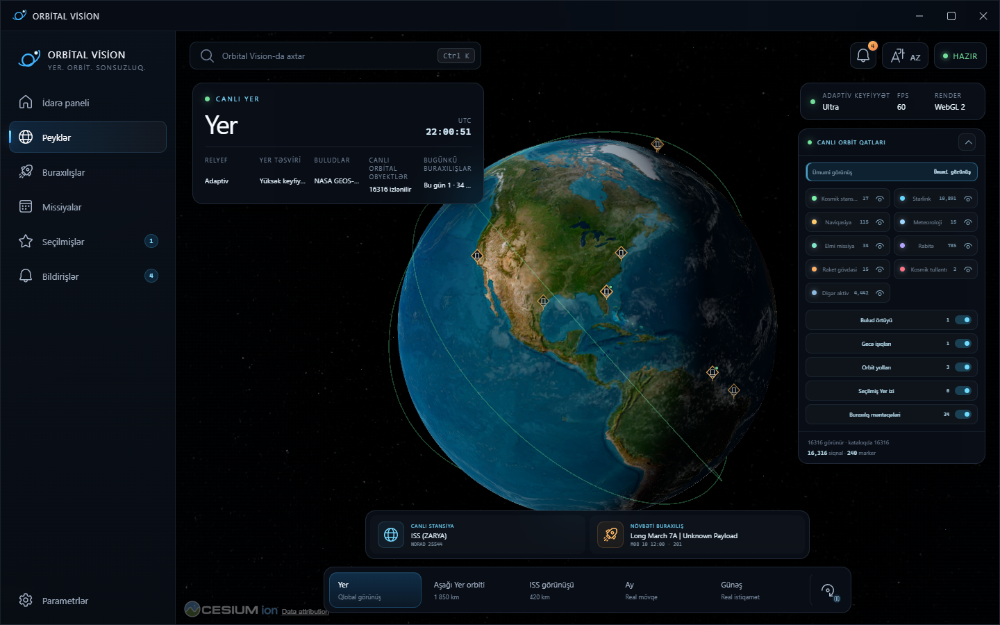
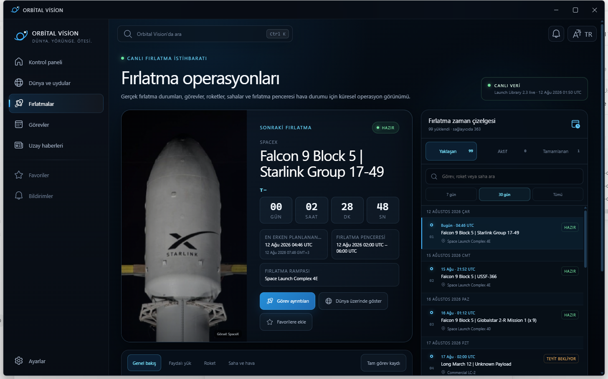
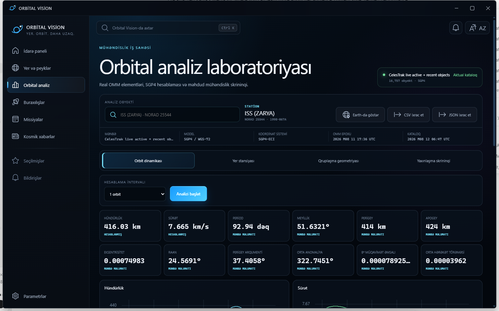
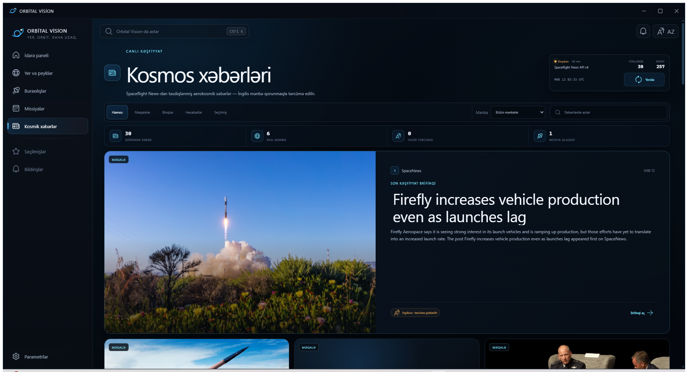
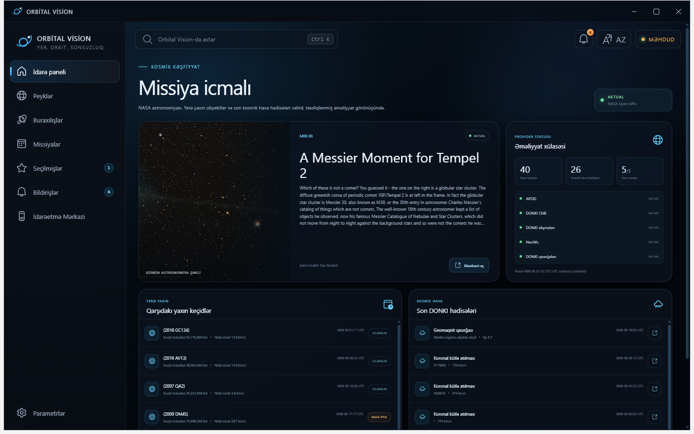

<p align="center">
  
</p>

<h1 align="center">Orbital Vision</h1>

<p align="center">
  Follow satellites, explore orbits, and keep up with what's happening in space.
</p>

<p align="center">
  <strong>Windows · macOS · Linux</strong><br>
  <sub>Built with Tauri, Rust, React and CesiumJS</sub>
</p>

<p align="center">
  <a href="#what-you-can-do">Features</a> ·
  <a href="#a-look-inside">Screenshots</a> ·
  <a href="#run-locally">Getting started</a> ·
  <a href="#documentation">Documentation</a>
</p>

Orbital Vision brings satellite tracking, orbital analysis, launch schedules and space news into one desktop app. Start with Earth, find an object by name or NORAD ID, and follow its orbit. From there, you can inspect a pass over a ground station, check an upcoming launch, or catch up on space weather without switching tools.

Data is cached on your device, with source and freshness information kept alongside it. When a provider is unavailable, the app can use its last saved data and tells you how old it is.

[](docs/screenshots/earth-ssa-native-overview-final.png)

## What you can do

- **Explore Earth and its satellites.** Move around a 3D globe, filter the orbital catalog, and select or follow individual objects. Inspect orbit paths and ground tracks, or use the Orbital Time Lens to explore a different time.
- **Work through an orbital question.** Inspect position and velocity, predict ground-station passes and Doppler shift, compare constellation geometry, and examine coverage or close approaches. Export analysis results as CSV or JSON. Mission-design tools let you explore what-if maneuvers.
- **Follow launches and missions.** Browse upcoming, active and completed launches, open rocket and launch-pad details, and check the forecast at the pad. Launches are linked to catalog objects when their international designators match.
- **Keep up with space weather and astronomy.** Read NOAA alerts and geomagnetic conditions alongside NASA astronomy images, near-Earth objects and solar events.
- **Read and find things again.** Browse Spaceflight News articles, blogs and reports, search the local archive, and save favorites. Use `Ctrl+K` to jump to satellites, launches, missions and other workspaces.

The interface is available in **English, Azerbaijani, Turkish, Russian and Spanish**, with language changes applied immediately. News translation uses an optional gateway; the original English text remains available.

## A look inside

<table>
  <tr>
    <td width="50%" valign="top">
      <a href="docs/screenshots/launch-operations-1440x900.png">
        
      </a>
      <br><strong>Launches and missions</strong><br>
      Countdown, launch window, pad details and the next missions on the schedule.
    </td>
    <td width="50%" valign="top">
      <a href="docs/screenshots/orbital-analysis-dynamics-1440x900.png">
        
      </a>
      <br><strong>Orbital analysis</strong><br>
      Catalog elements and calculated results, with their source, epoch and reference frame.
    </td>
  </tr>
  <tr>
    <td width="50%" valign="top">
      <a href="docs/screenshots/space-news-feed-1920x1080.png">
        
      </a>
      <br><strong>Space news</strong><br>
      Articles, source filters and a searchable archive stored on your device.
    </td>
    <td width="50%" valign="top">
      <a href="docs/screenshots/mission-platform-native-overview.png">
        
      </a>
      <br><strong>NASA overview</strong><br>
      Astronomy imagery, upcoming near-Earth approaches and recent solar activity.
    </td>
  </tr>
</table>

These captures show desktop development builds in Azerbaijani and Turkish. Layouts and provider data can change between versions. Select an image to view it at full size.

## Where the data comes from

| Source | Used for |
| --- | --- |
| CelesTrak | Orbital elements and satellite catalog metadata |
| Launch Library 2 | Launch schedules, missions, rockets and launch pads |
| Open-Meteo | Forecasts at launch-pad coordinates |
| NASA APOD, NeoWs and DONKI | Astronomy imagery, near-Earth objects and solar events |
| NOAA Space Weather Prediction Center | Alerts, R/S/G scales, planetary K-index and solar wind |
| Spaceflight News API | Articles, blogs and reports |

Satellite positions are calculated from catalog elements using SGP4 through satellite.js. They are predictions from an orbital model, not direct telemetry from the spacecraft. Accuracy depends on the age and quality of those elements.

The Rust backend handles provider requests, validation, retries and local caches. React handles the interface; dedicated workers handle orbital calculations. Space News and its translation cache use SQLite with full-text search.

NASA API keys are stored in the operating system's credential store. The frontend receives the key's status, never the key itself. The [privacy policy](PRIVACY.md) explains local storage and third-party requests in more detail.

## Run locally

You will need **Node.js 22.22.2+ LTS or 24.15+ LTS** (or Node 26+), **pnpm 11+** and **stable Rust**, plus the native build tools for your operating system:

| Platform | Native prerequisites |
| --- | --- |
| Windows | Visual Studio Build Tools with C++ support and WebView2 |
| macOS | Xcode command-line tools |
| Linux | WebKitGTK 4.1 and native libraries; the [build workflow](.github/workflows/desktop-release.yml) lists the packages used on Ubuntu |

From the repository root:

```sh
pnpm install
pnpm tauri:dev
```

Use `pnpm tauri:dev` for the complete desktop app. `pnpm dev` starts only the frontend, so features that depend on native commands will be unavailable.

The native process can read `NASA_API_KEY` from its environment or an ignored `.env.local` file during development. Previously saved credentials remain in the operating system's credential store; key management is no longer shown in Settings. Without a configured key, feeds use limited public NASA demo access, with a persistent six-hour attempt interval per feed (including failed requests) and daily APOD caching. Manual refresh cannot bypass this public quota protection. Shared-IP quotas can still make NASA data unavailable; cached results are preserved. For dependable production NASA access, provision a registered native credential or a separately operated authenticated gateway; never embed a private key in the distributed binary. See [NASA's access limits](https://api.nasa.gov/assets/html/authentication.html). Keep credentials out of frontend variables and source control.

News works in English without additional setup. To enable translations, configure the [translation gateway](services/translation-gateway/README.md).

## Development and builds

The interface uses React 19 and TypeScript, with CesiumJS for the globe, satellite.js for propagation, TanStack Query for asynchronous data and Zustand for application state. Tauri 2 connects it to the Rust host.

```sh
pnpm typecheck
pnpm lint
pnpm test
pnpm build
```

`pnpm production:check` also runs release-tooling tests, update-policy validation,
the complete frontend dependency audit and a working-tree secret scan. The
Production quality workflow runs these checks on every main-branch push and pull
request, with Windows native Clippy/tests and audits of both Rust lockfiles.

<details>
<summary><strong>Native and release checks</strong></summary>

```sh
cargo fmt --manifest-path src-tauri/Cargo.toml --all -- --check
cargo clippy --manifest-path src-tauri/Cargo.toml --all-targets --all-features --locked -- -D warnings
cargo test --manifest-path src-tauri/Cargo.toml --all-features --locked
cargo test --manifest-path services/translation-gateway/Cargo.toml --locked
pnpm test:release
pnpm release:validate
```

</details>

Build installers on the matching operating system:

| Target | Command | Packages |
| --- | --- | --- |
| Windows x64 | `pnpm tauri:build:windows` | NSIS `.exe`, `.msi` |
| macOS 12+ · Apple Silicon and Intel | `pnpm tauri:build:macos` | Universal `.dmg` |
| Linux x64 and ARM64 | `pnpm tauri:build:linux` | AppImage, `.deb`, `.rpm` |

These are the configured build targets. Installer availability and native verification are tracked through the [release checklist](docs/distribution/release-checklist.md). The [release guide](docs/distribution/cross-platform-release.md) covers platform dependencies, signing, checksums and packaging.

## Documentation

- [Architecture](docs/architecture) — application structure, Earth rendering, providers and storage.
- [Design decisions](docs/decisions) — the reasoning behind implementation choices.
- [Automatic updates](docs/distribution/automatic-updates.md) — signed updates and release policy.
- [Release readiness](docs/release-readiness) and [performance notes](docs/performance) — validation results and remaining work.
- [Screenshot archive](docs/screenshots) — more views of the application across sizes and languages.

## License and acknowledgements

Developed by **Israfil Isakhli**. Orbital Vision is proprietary software; use and redistribution are covered by the [license](LICENSE) and [terms](TERMS.md).

The app relies on public data providers, map imagery and open-source libraries. Credits and applicable notices are collected in [Third-party notices](THIRD_PARTY_NOTICES.md). Report security issues privately through the process in [SECURITY.md](SECURITY.md).

Orbital Vision is intended for exploration and analysis. It is not certified for navigation, launch operations, space-traffic coordination or collision-avoidance decisions.
